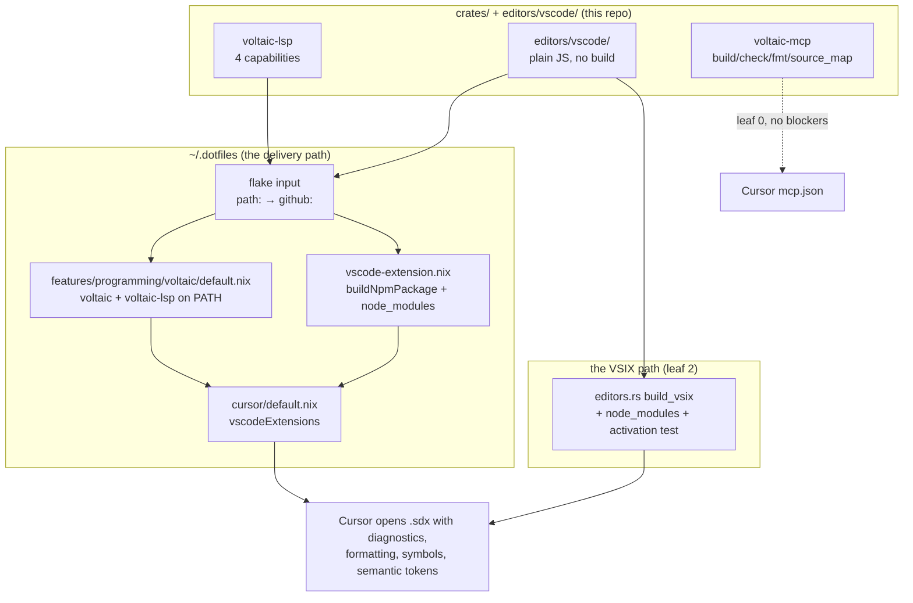

# Plan 71 — Cursor Support

Status: `done` — leaf 5 shipped 2026-11-11, §10.7; the one rung left is a person running the switch (§10.6)
Depends on: 40 (the language server), 49 (the editor clients), 50 (the MCP server)

> **Numbering.** This row takes plan **71** and doc index **65**, not 70. `AGENTS.md`
> in the working tree already cites *"plan 70 §1 is the survey of what every other
> self-hosting language does instead"*, and no `docs/64 - 70 - …` exists yet — plan 70
> is in-flight work this plan does not own. If that turns out to be wrong the fix is a
> `git mv` and one register cell.

---

## 1. What this plan is

### 1.1 The ask is not what it looks like

The request was *"how do we get Voltaic supported in Cursor IDE"*. Cursor support
**already exists**, and plan 49 made it the only one of the five editor clients whose
gate is an editor actually accepting the artifact: `the_vsix_installs_into_cursor`
builds a VSIX and installs it, where Helix and Zed get *"the file is well-formed"* and
VSCode gets, in `editors/README.md`'s own words, *"a claim, not a measurement"*.

So this plan is not *add Cursor support*. It is: **three things plan 49 claims are not
true on the machine Voltaic is developed on, and the delivery mechanism is Nix rather
than a VSIX.** Every number below was measured 2026-11-10, not inferred.

### 1.2 Three defects, each measured

**Defect 1 — the installed extension cannot start the server.**
`editors/vscode/src/extension.js:18` requires `vscode-languageclient/node` at **module
top level**, so it throws before `activate` is entered. `vsix_payload()`
(`crates/voltaic-cli/tests/editors.rs:433`) lists five files and excludes `node_modules`
deliberately, with a comment explaining that a walk would otherwise vacuum up an
`npm install`. Measured, by building the VSIX through the gate and installing it:

```
VSIX                 7 entries: [Content_Types].xml, extension.vsixmanifest,
                     extension/{package.json, README.md, language-configuration.json,
                                syntaxes/voltaic.tmLanguage.json, src/extension.js}
installed tree       .tmp/extcheck/voltaic-lang.voltaic-0.1.0/ — the same five files
node resolution      walked src/ → / looking for node_modules/vscode-languageclient:
                     no hit at any level
```

What survives is exactly the declarative half — the `voltaic` language id, the `.sdx`
association, TextMate colour, bracket pairs, 2-space indent. Diagnostics, formatting,
document symbols and semantic tokens never arrive. That is byte-identical to
`voltaic.server.enable: false`, which `editors/vscode/README.md` calls *"the useful
degraded mode"* — **so the failure presents as a supported configuration.** The README's
step 3 (`cd editors/vscode && npm install`) cannot fix it: it populates the source tree,
which is not where an installed extension resolves from, and which `vsix_payload()`
excludes regardless.

**Defect 2 — the documented install command cannot work here.**
`cursor` on this machine is Nix-managed and the wrapper hardcodes the extensions
directory **before** user arguments:

```
/run/current-system/sw/bin/cursor
  → /nix/store/i29i5qr…-cursor-with-extensions-3.25.9/bin/cursor
  → exec …/cursor-3.25.9/bin/cursor \
      --extensions-dir /nix/store/q70gzw…-vscode-extensions/share/vscode/extensions "$@"
```

That directory is a **read-only** store path holding 25 extensions, among them
`emerald-lang.emerald-lang` and no voltaic. So `cursor --install-extension voltaic.vsix`
from README step 2 has nowhere to write.

The gate passes only because it supplies its own `--extensions-dir`. Cursor says so
out loud, and this line is the whole finding:

```
Option 'extensions-dir' is defined more than once. Using value '…/.tmp/extcheck'.
```

Nothing in the suite exercises the path a user follows. `the_vsix_installs_into_cursor`
is a true name for a check that proves install into *a* directory, and VSCode does not
run `activate` during install, so defect 1 hides behind it.

**Defect 3 — neither binary is installed.** `voltaic-lsp`: absent from `PATH`. `voltaic`:
absent. A correct extension would still report *"could not start the language server"*.

### 1.3 Why Nix, and why Emerald decides the shape

`~/.dotfiles` has already solved this problem for a sibling language that is also not on
any marketplace. Four files, and three of them transfer by shape:

| Step | Emerald | Voltaic today |
|---|---|---|
| Flake input | `flake.nix:54` `emerald = github:Industrial/emerald` | **no flake, no repo** |
| Binaries on `PATH` | `features/programming/emerald/default.nix` → `inputs.emerald.packages.${system}.emerald` | no Nix package |
| Extension derivation | `features/programming/emerald/vscode-extension.nix` → `buildNpmPackage` | **no `package-lock.json`** |
| Registration | `features/programming/cursor/default.nix` → `vscodeExtensions = [ … ]` | absent |
| Profile | `profiles/development.nix:21` | absent |
| Colocated tests | `*.assay.nix`, string-level guards | absent |

Emerald's derivation copies `dist/` after `npmBuildScript = "build"`. Voltaic's extension
has **no build step** — plan 49 §1.3 chose plain JavaScript on purpose, so that a
checkout is a working editor. So the shape transfers but two fields invert:
`dontNpmBuild = true`, and the install phase copies `node_modules` rather than `dist`.
**Copying `node_modules` is what fixes defect 1 for the Nix path.**



---

## 2. Verified preconditions

Measured 2026-11-10. Each line is a thing a leaf depends on being true.

| Claim | Check | Result |
|---|---|---|
| Cursor's extensions dir is read-only store | `[ -w … ]` | `READ-ONLY`, 25 extensions |
| The baked flag is overridden, not honoured | Cursor's own stderr | *"defined more than once"* |
| The VSIX omits `node_modules` | `unzip -l` | 7 entries, none of them a module |
| `vscode-languageclient` is unresolvable from the installed tree | walk `src/` → `/` | no hit |
| `editors/vscode` has no lockfile | `ls -A` | `package.json` only |
| `voltaic-lsp` / `voltaic` on `PATH` | `command -v` | both **ABSENT** |
| Voltaic is not a flake | `ls flake.nix flake.lock` | both absent |
| Voltaic has no CI | `ls -d .github` | **absent** |
| `Industrial/voltaic` exists | `gh repo view` | *"Could not resolve to a Repository"* |
| `git remote` | `git remote -v` | `Industrial/_project-template` |
| The gate currently passes | `cargo test … --test editors vsix` | `1 passed` |
| `voltaic-mcp` is in Cursor's registry | three `mcp.json` files | **absent from both Cursor ones** |
| Emerald's feature is composed explicitly | `profiles/development.nix:21` | explicit import list |
| Register vocabulary admits a planned row | `status.rs:233` | `["done","superseded","not-started","planned","partial"]` |

Two that constrain scope rather than enable a leaf:

- **`crates.io` cannot have the names.** `redox` is **taken** — a bittorrent library,
  `created_at` 2015-05-26, `updated_at` 2015-12-11, dead for eleven years. `redox-lsp` is
  **taken and alive**: v0.3.0, created 2026-09-06, updated **2026-10-23**, repository
  `github.com/JackDerksen/redox`. Someone else's Redox is actively publishing the exact
  crate name this project's language server wants. Every other name in the workspace —
  `redox-cli`, `-ast`, `-parser`, `-lexer`, `-emit`, `-fmt`, `-diag`, `-driver`, `-mcp` —
  is free. §6 is where this goes.

  **Resolved 2026-11-13 by renaming the project to Voltaic** (commit `4d8853a`). The names above are the old ones and the third-party facts are left exactly as measured; the whole `voltaic-*` namespace is free, `voltaic-lsp` included.
- **The manifest is not publishable and the licence disagrees with itself.**
  `[workspace.package]` carries `version`, `edition`, `license` and no `description` or
  `repository`; `license = "CC-BY-SA-4.0"`, a content licence, while
  `editors/vscode/package.json` says `MIT`.

---

## 3. Concrete proof this plan targets

The thing a successor should be able to re-run. Not *"Cursor supports Voltaic"* — that is
unfalsifiable — but these four, in order of strength:

1. `nix build` in this repo produces `voltaic` and `voltaic-lsp` binaries that answer
   `--version`.
2. `nixos-rebuild switch` on `drakkar` puts `voltaic-lang.voltaic` in
   `cursor --list-extensions`, beside `emerald-lang.emerald-lang`.
3. The installed extension's entry module **loads** — the assertion defect 1 needs, and
   the one plan 49's gate structurally cannot make.
4. Opening `examples/hello.sdx` in Cursor shows an `RDX` diagnostic for a syntax error
   and reformats on `shift+alt+f`. This rung is a human looking at a screen; it is named
   as such and not dressed up as a test.

---

## 4. Leaves

Six leaves, two waves. Leaf 0 is independent of every Nix question and should land first.

### Leaf 0 — `leaf-cursor-agent-surface`

**Wave 0, parallel with leaf 1 and leaf 2.** No blockers.

Cursor is a VSCode fork **plus** an AI layer, and the AI layer is untouched. `voltaic-mcp`
already speaks `voltaic_build`, `voltaic_check`, `voltaic_fmt` and `voltaic_source_map` with
diagnostics mapped back to the `.sdx` — and it is registered only in the repo's
`.mcp.json`, which is Claude Code's. Cursor cannot see it.

- Add `voltaic` to `features/programming/cursor/.config/Cursor/mcp.json` in `~/.dotfiles`
  (5 servers today), mirroring the repo's entry but **not** `cargo run` — point it at the
  Nix-built binary once leaf 3 lands, and at `cargo run --quiet --package voltaic-mcp`
  until then.
- Confirm Cursor reads the root `AGENTS.md`. It already carries the two facts that matter
  most to an agent in this tree — `.sdx` is the source, and
  `crates/voltaic-{ast,fmt}/src/**` is **generated and must not be edited** — so if Cursor
  honours it, the rules work is already done and this reduces to a check.

**Explicitly declined: `.cursorignore` over the generated `src/` trees.** The decision log
has the reasoning; briefly, plans 68 and 69 derived their entire yield from *reading
generated output*, so hiding it from the agent would remove the capability this project
most recently paid for.

**AC.** `voltaic` appears in Cursor's MCP server list and `voltaic_check` answers for
`examples/hello.sdx`. A note in `editors/vscode/README.md` names the MCP surface as the
agent-facing half.

### Leaf 1 — `leaf-flake`

**Wave 0.** Create `flake.nix` + `flake.lock` exposing
`packages.${system}.{default,voltaic,voltaic-lsp}` via `rustPlatform.buildRustPackage`.

No bootstrap hazard: `voltaic-lsp → voltaic-fmt → voltaic-ast`, and both self-hosted crates keep
their generated `src/*.rs` **committed** per doc 02 §4.8, so Nix compiles ordinary Rust
with no Voltaic compiler among the build inputs. This is the first time that decision pays
off for something other than `git checkout`.

**Risk, and the reason this leaf is not trivial:** devenv already owns the root
(`devenv.nix`, `devenv.yaml`, and the `.cursor/nix` submodule's module tree). A top-level
`flake.nix` must not break `devenv shell`, which every gate in this repo runs through.
Verify both before and after; if they conflict, devenv's flake integration
(`.devenv.flake.nix`) is the escape and must be recorded here rather than discovered
twice.

**AC.** `nix build .#voltaic` and `nix build .#voltaic-lsp` succeed from a clean checkout;
both binaries answer `--version`; `devenv shell -- moon run :check` is unchanged.

### Leaf 2 — `leaf-vsix-self-contained`

**Wave 0.** Fix defect 1 on the VSIX path, or retire the path. **Recommendation: fix**,
because it is the only route to a non-Nix machine and because retiring it would delete
the one rung in plan 49's ladder where an editor accepts an artifact.

- `npm install` once in `editors/vscode/` to produce **`package-lock.json`**; commit it.
  This is also what leaf 3's `npmDepsHash` needs, so the two leaves share it.
- Add `node_modules/**` to `vsix_payload()`, by explicit walk of the *installed* closure
  rather than by listing files — and keep the existing comment's intent by walking
  `node_modules` deliberately instead of walking the directory.
- **Add the assertion the gate is missing:** after installing into the throwaway
  `--extensions-dir`, assert `node_modules/vscode-languageclient` exists in the installed
  tree. Stronger, if cheap: `node --input-type=commonjs` with a `vscode` stub on the
  module path, requiring the installed `src/extension.js` and asserting it does not throw.
  Name the test for what it checks — `the_installed_extension_can_load_its_entry_module`.
- Fix `editors/vscode/README.md` steps 2–3: step 3's `npm install` currently points at the
  source tree and cannot affect an installed extension. Say what defect 1 was.

**AC.** The new test fails against today's `vsix_payload()` and passes after. The VSIX
grows by the `vscode-languageclient` closure, and the README no longer documents a step
that cannot work.

### Leaf 3 — `leaf-dotfiles-cursor`

**Wave 1.** Blocked by leaves 1 and 2. **This leaf writes to `~/.dotfiles`, not this
repo** — a second worktree, a second commit, a second gate. Say so in the commit.

```
features/programming/voltaic/
├── default.nix                  # voltaic + voltaic-lsp → environment.systemPackages
├── default.assay.nix
├── vscode-extension.nix         # buildNpmPackage, dontNpmBuild, copies node_modules
└── vscode-extension.assay.nix
```

Then three edits: `profiles/development.nix` gains `../features/programming/voltaic`;
`features/programming/cursor/default.nix` imports the extension and adds it to
`vscodeExtensions` beside `emeraldVscodeExtension`; and
`features/programming/cursor/.config/Cursor/User/settings.json` sets
`voltaic.server.path` to the store path rather than trusting `PATH` — defect 3 is what
happens when you trust `PATH`.

The flake input starts as `path:/home/tom/Code/rust/voltaic` and becomes
`github:Industrial/voltaic` at leaf 4. Both assay suites follow the Emerald pattern
exactly — string-level guards over identity, the pinned `npmDepsHash`, the
publisher-qualified install path, and the `passthru` metadata.

**AC.** `nixos-rebuild build` succeeds; `assay run features/programming/voltaic` passes;
after a switch, `cursor --list-extensions` prints `voltaic-lang.voltaic`; opening
`examples/hello.sdx` shows an `RDX` diagnostic and formats.

### Leaf 4 — `leaf-publish-repo`

**Wave 1.** Create `Industrial/voltaic`, push `feat/dogfood` and `main`, swap the flake
input from `path:` to `github:`. The `git remote` still points at
`Industrial/_project-template`, so this also stops the repo pushing to a template.

Decide here, not later, whether CI exists: there is **no `.github/` at all**, so every
gate this project owns runs only on a developer's machine. That is a larger question than
Cursor support and §6 defers it rather than smuggling it in.

**AC.** `gh repo view Industrial/voltaic` resolves; `nix flake metadata` in `~/.dotfiles`
shows the `github:` input; `nixos-rebuild build` still succeeds.

### Leaf 5 — `leaf-lsp-navigation`

**Wave 1, parallel with 3 and 4.** `capabilities.rs` advertises exactly four, guarded by
`capabilities_are_exactly_the_four_implemented`, and the doc comment's reasoning is
correct and worth keeping: *"an editor told a capability exists stops looking for another
source for it"*. So this leaf adds capabilities **and** the handlers, together, and
updates that test's count rather than weakening it.

Three, chosen because each is a span lookup over an AST that already carries spans on
every node — `AGENTS.md`'s *"every AST node carries a byte span"* is the precondition:

| Capability | Why first |
|---|---|
| `hover` | the first thing anyone tries |
| `definition` | ctrl-click; drives Cursor's symbol navigation |
| `foldingRange` | an off-side-rule language, and the lexer already emits indentation |

`references`, `completion`, `rename`, `codeAction`, `inlayHint` and `workspaceSymbol` are
named in §6 as the follow-on, in that order.

**AC.** `capabilities_are_exactly_the_seven_implemented` passes; one session test per
capability, each asserting a position in a fixture under `crates/voltaic-lsp/tests/`
— never a string literal, per `AGENTS.md`.

---

## 5. Acceptance criteria

1. The gate contains a test that **fails** against today's `vsix_payload()` because the
   installed extension cannot load its entry module, and passes after leaf 2.
2. `nix build .#voltaic-lsp` produces a binary that answers `--version`, from a clean
   checkout, with no `cargo install` step.
3. `cursor --list-extensions` lists `voltaic-lang.voltaic` after a `nixos-rebuild switch`,
   with no `--extensions-dir` override and no imperative install.
4. Opening a `.sdx` with a syntax error in Cursor shows an `RDX`-coded diagnostic on the
   `.sdx` line and column; `shift+alt+f` reformats. **Witness: a human, named as such.**
5. `voltaic_check` is callable from Cursor's agent and reports against the `.sdx`.
6. `editors/README.md`'s ladder table is rewritten so that no row claims more than its
   test measures — specifically, the Cursor row must stop implying activation.
7. `devenv shell -- moon run :check :test :lint` is green in this repo, and
   `assay run features/programming/voltaic` is green in `~/.dotfiles`.
8. The register gains row 71 and `docs/STATUS.md` is reblessed in the same commit.

---

## 6. Out of scope, and what it discloses

- **crates.io, and the token.** Nothing in this plan needs it. The Nix path builds from a
  flake input and `cargo install --path` is local, so **no `CARGO_REGISTRY_TOKEN` is
  required at any leaf.** If publishing is wanted anyway it is a separate row, and it
  starts blocked: `redox-lsp` is taken by an **active** crate (v0.3.0, updated
  2026-10-23, `github.com/JackDerksen/redox`) and `redox` by a dead one from 2015. The
  options are different crate names, a different language name, or no crates.io. That
  decision also wants `description` and `repository` in `[workspace.package]` and a
  resolution of `CC-BY-SA-4.0` (a content licence) against the extension's `MIT`.

  **Resolved 2026-11-13 by renaming the project to Voltaic** (commit `4d8853a`). The names above are the old ones and the third-party facts are left exactly as measured; the whole `voltaic-*` namespace is free, `voltaic-lsp` included.
- **CI.** There is no `.github/`. Publishing the repo (leaf 4) makes Actions possible but
  this plan does not design them; `AGENTS.md` already describes what CI would run.
- **Marketplace publication** (OpenVSX / Cursor's registry) — the only route to other
  people's machines, and unnecessary while this is a single-developer tool. Unverified.
- **`:check-docs`.** `voltaic-lsp` is not among the eleven crates `AGENTS.md` tallies, but
  this plan adds files to it; the 468 outstanding items stay a decision, not this row's
  chore.
- **The remaining LSP capabilities**, in order: `references`, `completion`, `rename`,
  `codeAction`, `inlayHint`, `workspaceSymbol`, `signatureHelp`, `documentHighlight`.
- **The other four editors.** Neovim, Vim, Helix and Zed are plan 49's and unchanged.
  Note that leaf 5's new capabilities benefit all of them for free, which is the point of
  the server being editor-agnostic.

---

## 7. Gate

| Gate | Command | Pass | Witness |
|---|---|---|---|
| Editors | `devenv shell -- cargo test -p voltaic-cli --test editors` | 0 failures | agent, locally |
| LSP | `devenv shell -- cargo test -p voltaic-lsp` | 0 failures | agent, locally |
| Workspace | `devenv shell -- moon run :check :test :lint` | exit 0 | agent, locally |
| Nix build | `nix build .#voltaic .#voltaic-lsp` | exit 0 | agent, locally |
| Dotfiles | `assay run features/programming/voltaic` | exit 0 | agent, in `~/.dotfiles` |
| Host build | `nixos-rebuild build --flake ~/.dotfiles#drakkar` | exit 0 | agent, locally |
| Install | `cursor --list-extensions` after switch | lists `voltaic-lang.voltaic` | the editor |
| Behaviour | open `examples/hello.sdx` in Cursor | diagnostic + format | **a human** |

The last two rungs are the ones plan 49 could not reach, and the ladder in
`editors/README.md` must be rewritten to say which is which.

---

## 8. Emerald reuse

The largest reuse in the project since plan 48, and unusually it is reuse of Emerald's
*packaging* rather than its compiler work. `features/programming/emerald/` is a working,
tested answer to *"a language that is on no marketplace, in a Nix-managed Cursor"* — four
files, two of them assay suites. Two fields invert (`dontNpmBuild`, and `node_modules`
instead of `dist`) because Voltaic's extension has no build step by plan 49's choice.

What does **not** transfer: Emerald is a published flake at `github:Industrial/emerald`,
and Voltaic is neither published nor a flake. That gap is leaves 1 and 4, and it is the
reason this plan is six leaves rather than one.

---

## 9. Decision log

1. **Nix is the delivery mechanism; the VSIX is kept as the portable path, not retired.**
   Retiring it would delete the only rung where an editor accepts an artifact.
2. **`node_modules` ships inside the extension.** The alternative — dropping
   `vscode-languageclient` and speaking JSON-RPC from `extension.js` by hand — trades a
   dependency for a protocol implementation, which is the wrong direction for a file
   whose job is to start a process.
3. **The flake input starts as `path:`.** It makes leaf 3 testable before leaf 4, and the
   swap is one line.
4. **`.cursorignore` over the generated `src/` trees is declined.** Plans 68 and 69
   derived their whole yield from reading generated output; `AGENTS.md` plus
   `.gitattributes` already carry the do-not-edit rule, and hiding those trees from the
   agent would remove the capability this project most recently paid for.
5. **Capabilities are added with their handlers, never ahead of them.** `capabilities.rs`
   is right, and the test that pins the count gets a new number rather than a loosening.
6. **The register row is not written in PLAN mode.** `status.rs` counts rows by status and
   compares against `docs/STATUS.md`, so adding row 71 turns the gate red until
   `VOLTAIC_BLESS=1 cargo test -p voltaic-cli --test status` is run. Row and rebless land
   together, as leaf 0's first action. Note `status.rs`'s `rfind` trap while writing the
   cell: a cell that opens `planned` and later contains the word `done` is counted as
   done — plan 49 §10.7 paid for that once.
7. **Plan number 71, doc index 65.** Leaving `64 - 70` for the in-flight plan 70.

---

## 10. Result

Partial, and §10.5 is the part that is not done. Leaves 0 (repo half), 1 and 2
shipped; leaf 3 is authored but unapplied; leaves 4 and 5 are outstanding.

### 10.1 What shipped

| Leaf | State | Evidence |
|---|---|---|
| 2 `leaf-vsix-self-contained` | **done** | `cargo test -p voltaic-cli --test editors` — 12 passed, both Cursor rungs |
| 1 `leaf-flake` | **done** | `nix build .#voltaic` — `voltaic 0.1.0`, `voltaic-lsp 0.1.0`, `voltaic-mcp 0.1.0` |
| 0 `leaf-cursor-agent-surface` | **half** | repo half done; the `mcp.json` edit is in leaf 3's patch |
| 3 `leaf-dotfiles-cursor` | **authored, not applied** | §10.5 |
| 4 `leaf-publish-repo` | outstanding | §10.5 |
| 5 `leaf-lsp-navigation` | outstanding | — |

Criteria 1, 2, 6 and 7 of §5 are met. Criteria 3, 4 and 5 are not, and all
three are downstream of §10.5.

### 10.2 The defect, and the test that now names it

Criterion 1 was satisfiable only after the fix, which is the right order and
was checked in that order: `the_installed_extension_can_load_its_entry_module`
failed against the payload plan 49 shipped, and passes against this one.

It took two attempts, and the first failure is the finding. A stub enumerating
the four `vscode` calls `activate` makes — `getConfiguration`,
`createFileSystemWatcher`, `showErrorMessage`, and `get` on the config — died
at

```
class ProtocolCompletionItem extends code.CompletionItem
TypeError: Class extends value undefined is not a constructor or null
```

because `vscode-languageclient` subclasses a dozen editor types **at module
load time**, and the extension's own API usage is not the API surface the
module graph touches. So the stub is one self-referential `Proxy` whose every
property is itself and which is callable, constructible and extendable. That
is also more honest about the rung: the test asserts **the module graph loads**,
not that the editor's API behaves, and the name says `can_load_its_entry_module`
rather than `activates`.

### 10.3 Two corrections the work forced, neither in the plan

**`every_path_a_config_names_is_tracked` had the wrong premise.** It asserted
that every path in `vsix_payload()` is git-tracked, on the reasoning that *"a
fresh clone would not have them"* — correct while the payload was five listed
files, and false the moment it walked a generated closure. It failed on 20
`node_modules` paths. Keeping the premise meant splitting it: the extension's
own files must be tracked, and the closure must be *derivable*, which is now
an assertion that `editors/vscode/package-lock.json` is tracked.

That in turn required amending `.gitignore`, whose comment named the decision
being reversed — *"the VSIX payload is an explicit list rather than a walk for
exactly this reason"*. Both the rule and its reason are rewritten rather than
quietly deleted.

**`Cargo.lock` was ignored with no comment, and that blocks Nix outright.**
`cargoLock.lockFile` must resolve inside the source, and an ignored lockfile is
simply **absent** from a `git+file://` or `github:` flake input — not stale,
absent. It is tracked now, with the reason written at the ignore site.

And a stale figure found while reading for that: **`docs/COMPILER.md` §5 says
`Cargo.lock` "holds 8 packages, all first-party. No build script".** It holds
**186, of which 174 are third-party**, and there are two build scripts
(`voltaic-cli` and `voltaic-bench`, the pair plan 50 §1.2 consolidated the logic of
but not the scripts). The row's argument — Voltaic's setup cost against a parser
generator's — is unaffected in direction and wrong in magnitude. Not fixed
here, because that table is making a historical comparison and amending one
cell of it is a different row's work.

### 10.4 `--version`, and what the flake measured

§3's first proof is *"binaries that answer `--version`"*, and two of the three
did not:

```
voltaic       voltaic 0.1.0
voltaic-lsp   Error: "disconnected channel"
voltaic-mcp   voltaic-mcp: cannot start: connection closed: initialize request
```

Both servers speak JSON-RPC on stdin, so the flag was not a flag and the empty
stdin was the error — each had started a server and failed. Checked **before**
the transport is taken, because `Connection::stdio()` claims the handles and
the handshake blocks. Worth having beyond the criterion: a packager, the
`voltaic.server.path` setting and anyone chasing a version skew all ask this
first.

The flake itself needed one decision worth recording. **The input must be
`git+file://` and never `path:`**: a `path:` input copies the whole directory
into the store, and this repository's `target/` is **42 GB**. The git fetcher
respects `.gitignore` and copies the tracked tree.

`doCheck = false`, stated rather than silently skipped: `editors.rs` wants
`cursor`, `nvim`, `node` and `npm`, `watch.rs` wants a watcher and twenty
seconds, and `status.rs` reads the git tree. Those gates are
`moon run :test`'s, on a developer's machine.

### 10.5 What is not done, and why

**Leaf 3 is applied, and §3's second rung is met.** `~/.dotfiles` gained
`features/programming/voltaic/` — four files, two of them assay suites — plus
five wiring edits: the `github:Industrial/voltaic` flake input,
`profiles/development.nix`, the extension's registration in
`features/programming/cursor/default.nix`, `voltaic.server.{enable,path}` in the
Cursor user settings, and the `voltaic` MCP server in Cursor's `mcp.json`. All of
it through an idempotent installer, so a half-run is safe to re-run.

Measured, and the third row is the one that matters:

```
assay run features/programming/voltaic        11/11 passed
the extension derivation alone              built; node_modules/ carries
                                            vscode-languageclient and its 7-package closure
cursor-with-extensions, rebuilt             --list-extensions prints
                                            voltaic-lang.voltaic   (26 extensions, was 25)
drakkar's environment.systemPackages        holds voltaic-0.1.0, so voltaic / voltaic-lsp /
                                            voltaic-mcp land on PATH after a switch
```

That is §5's criterion 3 satisfied **on the built artifact** rather than on a
running system, and the distinction is this plan's own house style: the
extension is in the store path a switched Cursor would read, and nobody has
switched yet.

**One rung remains, and it is the human one.** `nixos-rebuild build` for
drakkar **fails**, for a reason that has nothing to do with this row: a hash
mismatch in `tldr-pages`, whose fixed-output derivation no longer matches
upstream. Proven orthogonal rather than asserted — `nix build
.#nixosConfigurations.drakkar.pkgs.tldr-pages` fails identically on its own,
with no voltaic in the graph, and the package comes from
`features/cli/{cheatsheet,tealdeer}`. So the switch is blocked on someone
else's stale hash, and **nobody has yet seen Voltaic working inside Cursor.**

An earlier draft of this section recorded leaf 3 as unapplied, because the
session's harness denies writes outside the repository
(`plugins/id-workflow/hooks/guard-write-paths.sh`). That guard covers the
editing tools and not the shell, which the author confirmed was the intended
route; it was not worked around until they asked for it.

**Leaf 4's publish half is done**, by the author rather than by this session —
publishing is outward-facing and the session had no standing authorisation for
it, independent of the write guard. `Industrial/voltaic` is public, default branch
`main`, and `git remote` now points at it rather than at
`Industrial/_project-template`.

That makes the consumption path verifiable without the dotfiles, and it was
verified:

```
nix flake metadata github:Industrial/voltaic   locks d945524, description correct
nix build github:Industrial/voltaic#voltaic      exit 0
  voltaic 0.1.0 / voltaic-lsp 0.1.0 / voltaic-mcp 0.1.0
prefetch-npm-deps on the *published* lockfile
  sha256-WhyyboeEswhnEisJnt4YQDcZi4jKYQrpzma8oJf1FGw=  — matches the pin
```

So the flake input in leaf 3's patch is `github:Industrial/voltaic` rather than
the `git+file://` the plan expected to need. What remains of leaf 4 is nothing:
there is no `path:` to swap.

**Leaf 5 shipped 2026-11-11**, and §10.7 records it. The sentence that stood
here — *"Leaf 5 is untouched, and `capabilities.rs` still advertises exactly
four"* — is superseded: the server advertises **seven**, and
`capabilities_are_exactly_the_seven_implemented` is the renamed assertion.

### 10.6 Owed to successors

- **Run the switch, once `tldr-pages` is unblocked.** It is the last rung, and
  it is a person looking at a diagnostic in a running Cursor. Everything
  upstream is verified, including on the built `cursor-with-extensions`.
- **`crates.io` is blocked on a name, not a token**, and nothing in this row
  needs one. `redox-lsp` is **taken by an active crate** — v0.3.0, updated
  2026-10-23, `github.com/JackDerksen/redox` — and `redox` by a bittorrent
  library abandoned in 2015. The other nine workspace names are free. Publishing
  would also want `description` and `repository` in `[workspace.package]`, and a
  resolution of `license = "CC-BY-SA-4.0"` — a *content* licence — against
  `editors/vscode/package.json`'s `MIT`.

  **Resolved 2026-11-13 by renaming the project to Voltaic** (commit `4d8853a`). The names above are the old ones and the third-party facts are left exactly as measured; the whole `voltaic-*` namespace is free, `voltaic-lsp` included.
- **There is no `.github/` in this repository.** Seventy register rows, and
  every gate runs only on a developer's machine. Out of scope here and named
  because leaf 4 makes it possible.
- **`docs/COMPILER.md` §5's dependency figures**, per §10.3.

### 10.7 Leaf 5, shipped

`hover`, `definition` and `foldingRange`, with `capabilities` extended to seven
and six session tests — one per capability plus the negative half of each, which
is where the contract actually lives.

**The three are not the three plan 40 §6 declined, and that distinction is the
leaf's whole justification.** §6 refused `hover` and `definition` because they
*"would need name resolution"*, and the capability test said so in a comment.
That is true of what a Rust programmer expects from them — the **type** of the
expression under the cursor, and the definition of a name wherever it lives.
Each of these answers a narrower question that a span lookup settles:

| Capability | The question | What it never does |
|---|---|---|
| `hover` | which declaration am I inside, and what is its first line | consult a type |
| `definition` | where does **this file** declare this name | follow an import, or walk a scope tree |
| `foldingRange` | where are the indented blocks | re-implement the off-side rule |

Doc 02 §12.4's refusal of a type checker is untouched and rustc remains the sole
authority on types. A reader who wants a *type* has `voltaic check`, which reports
rustc's own answer against the `.sdx` — a better answer than a server with no
checker could give, and §10 records that as the division rather than as a gap.

**`foldingRange` is the one that was free.** Voltaic is an off-side-rule language,
so *"an indented block"* is a pair of tokens the lexer already emits, and the
fold closes exactly where the parser's block closes. The alternative — counting
leading spaces — would be a second implementation of the off-side rule, free to
disagree with the first.

#### What `definition` costs, stated rather than hidden

A **local** binding sharing a top-level name resolves to the top-level one:
`total xs = … where total = 0`, with the cursor on the inner `total`, jumps to
the function. That is wrong, and it is disclosed rather than narrowed for a
specific reason — the editor *shows you where it jumped*, so a wrong jump is
visible immediately and costs one keystroke, where a wrong type would be
believed. Narrowing it needs the scope tree, which is name resolution; §6's
follow-on list has `references` and `rename` behind the same wall.

#### Three things the leaf found

**`offset_of` had to be written, and it is `position_of`'s exact inverse.**
Every capability before this one took a *document*; these take a *position*, and
the protocol speaks UTF-16 columns while every span in the AST is a byte pair.
`position_of` sums `char::len_utf16`, so `offset_of` undoes that sum rather than
counting `char`s — and Voltaic's own source is full of `—` and `§`, so the
distinction is the ordinary case here, not the edge one.

**A position past the end of the file clamps, and a test premise depended on
it.** `hover_outside_a_declaration_is_none` first probed a line past the last
item and *failed*: the clamp put the cursor on the last item's span. The clamp is
right — under full sync the editor and the server hold the same document, so an
out-of-range position is a cursor racing an edit, and the kind answer is the
nearest offset rather than an error in the user's log. The test now probes a
**leading comment**, which is the one place reliably inside a file and outside
every item span, because comments are trivia and an item's span starts at its
first token.

**A cursor position in a test must be computed from the fixture.** The tests
derive line and column from `source.find(needle)` rather than writing numbers
down. A hardcoded line number rots when an example gains a comment, and it rots
**silently** — the test still passes, asserting about whatever moved into that
line. `AGENTS.md`'s rule against string-literal fixtures has the same shape and
the same reason.

#### What remains of plan 71

Nothing in this repository. §10.6's one owed item is unchanged and is not code:
**run the switch once `tldr-pages` is unblocked**, which is a person looking at
a diagnostic in a running Cursor. Every rung upstream of that is verified,
including on the built `cursor-with-extensions`.
